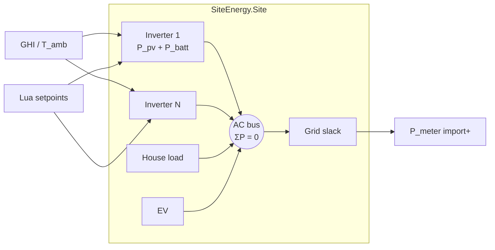
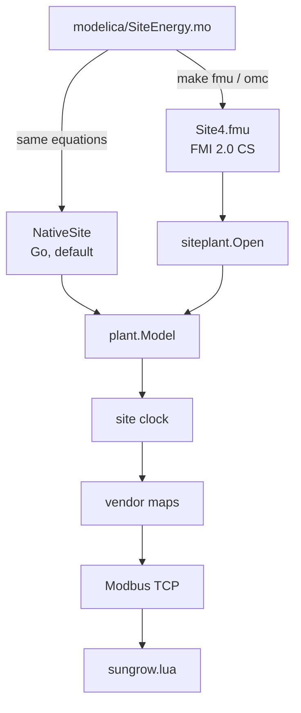

# Site plant sketch

This is the picture of a **site** as one electrical node, with physics as a
module that can be swapped. The drawing:


Source of the bus equation: [`modelica/SiteEnergy.mo`](../modelica/SiteEnergy.mo).
Go stand-in (no OpenModelica required): `internal/plant.NativeSite`.
Compiled Modelica: `make fmu` then `siteplant.Open`.
Lua talks only Modbus: [`srcfl/device-drivers`](https://github.com/srcfl/device-drivers).

## What is in the sketch

Three strips, left to right:

1. **Plant** — Modelica connectors on an AC bus. Inverters inject `P_pv + P_batt`. House and EV consume. Grid is slack. `P_meter = -grid.P` so Lua import is positive.
2. **Facade** — semantic watts become vendor registers. No physics here.
3. **Lua** — `driver_poll` / `driver_command` over Modbus TCP. Not the HTTP API.

Under the plant: the **site clock** is the only integrator. Scenario `physical` calls `StepSite(dt)` once per tick.

## Connection law



`flow P` is positive **into** the component. That is the Modelica convention and it matches the Lua sign table after `P_meter = -grid.P`.

## Plug



Keep self-consumption slack in the **master** (Go). A mode-0 battery must see every other unit's live Lua write in the same step. Putting that algebraic loop inside the FMU makes the slave non-causal.

## Tick

```text
site tick (dt includes time acceleration)
  read P_load from site phase loads
  read Control from each inverter's holding registers  ← Lua writes land here
  NativeSite.StepSite(dt)  or  Site4.fmu via siteplant
    preview PV from GHI
    EMS/forced batteries follow setpoint
    mode-0 batteries share residual so the meter wants to be ~0
    export cap curtails PV if needed
    integrate SoC
  write semantic registers
  write site meter (P_grid on phases, then fuses)
```

## Out of scope for this sketch

- Full 3-phase electrical (only power split by `phase_factors`)
- MPPT tracking dynamics, transformer impedance
- FMU parameterisation of rated power (Site4 is fixed at 8 kW / 10 kWh per slot)

Thermal networks (lumped building + ASHP/GSHP + DHW) live in `NativeSite` and
in `modelica/SiteEnergy.mo` (`Building`, `HeatPump`, `DHWTank`). See
[SITE_SIMULATOR.md](SITE_SIMULATOR.md).

